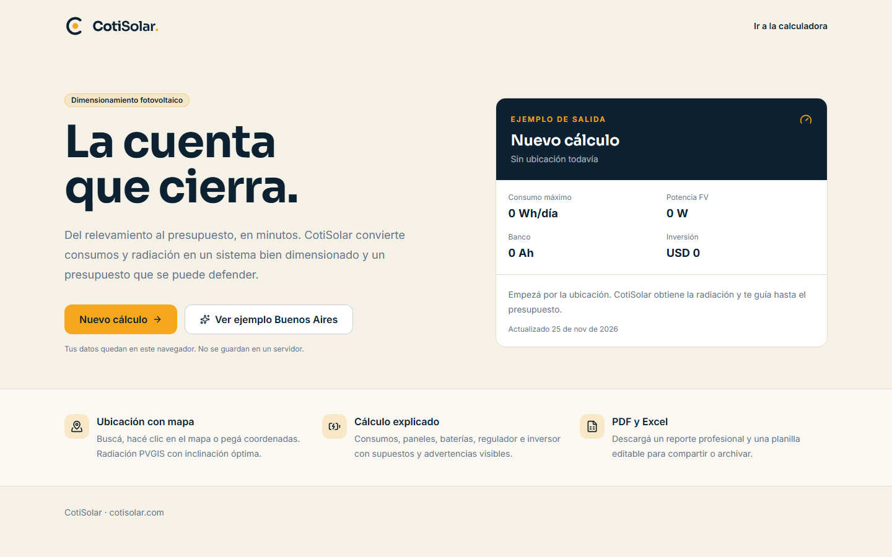
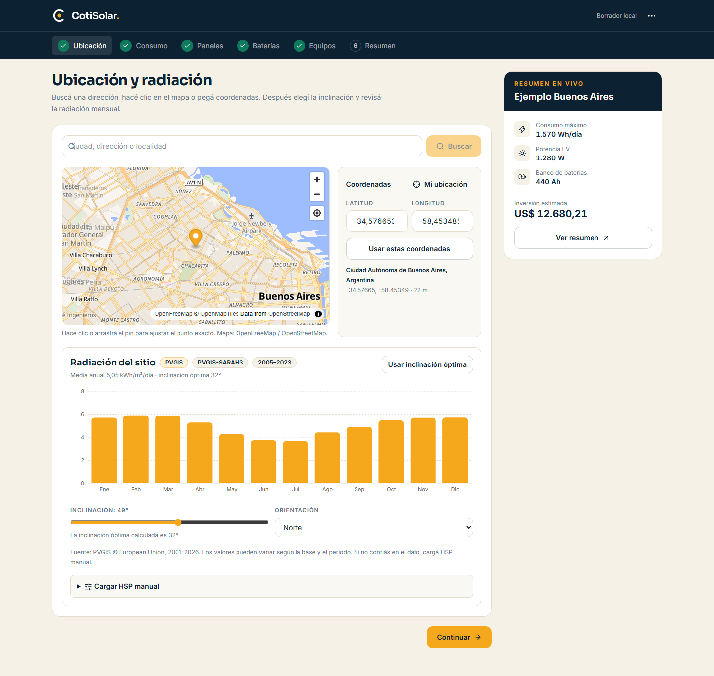
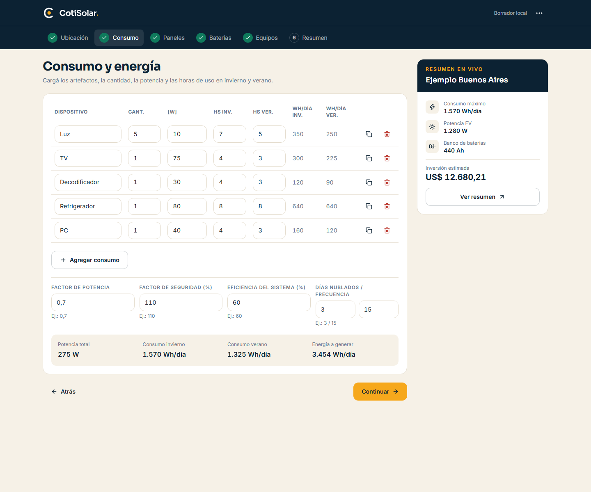
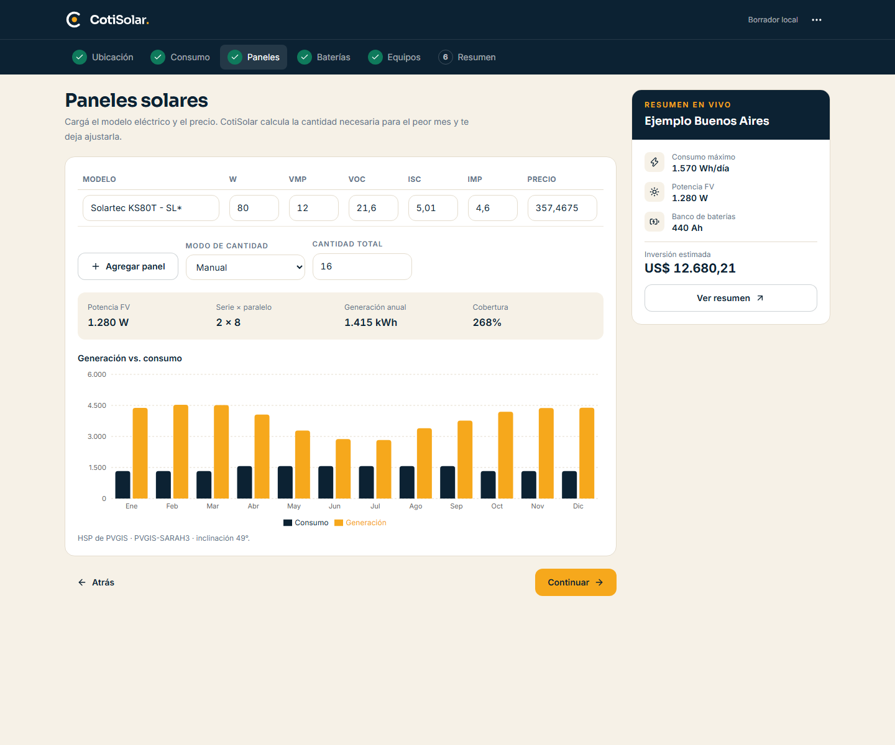
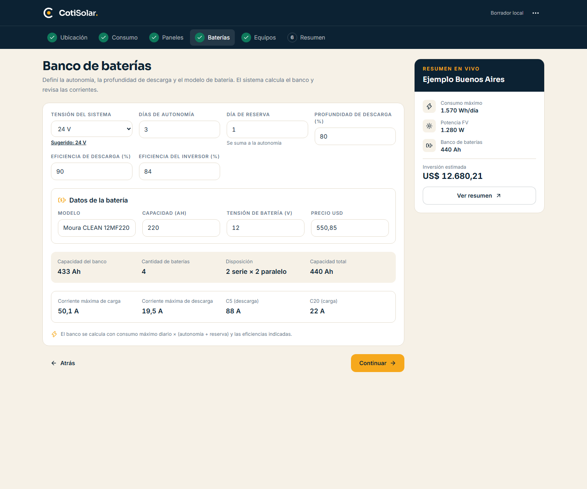
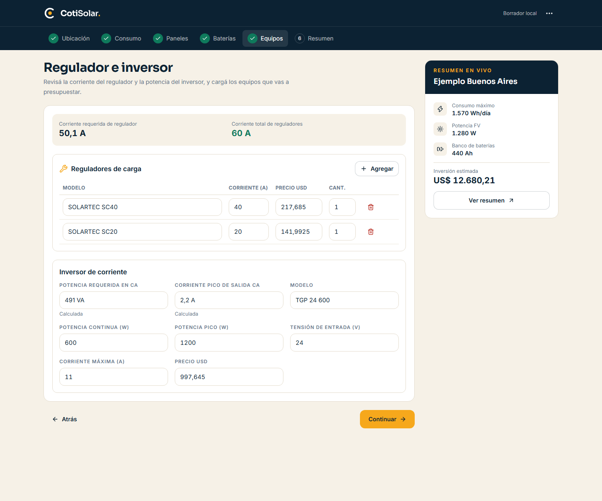
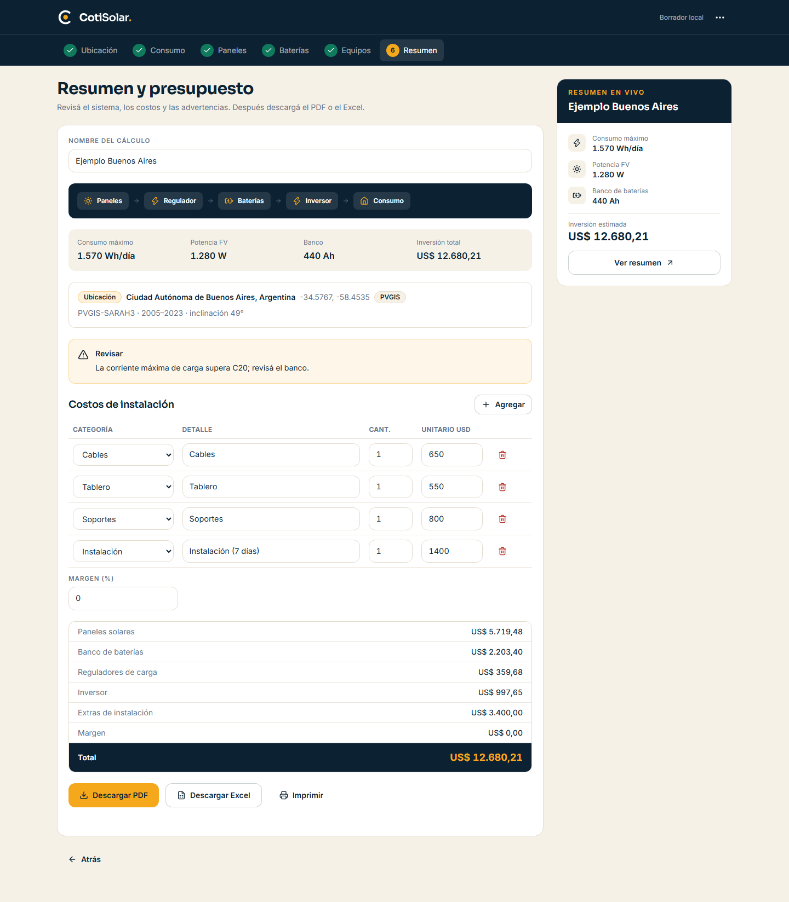
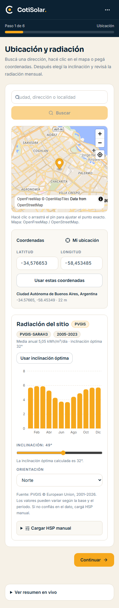

# CotiSolar

<div align="center">
  
  <h3>La cuenta que cierra.</h3>
  <p>Del relevamiento al presupuesto fotovoltaico, en minutos.</p>

  <p>
    
    
    
    
    
  </p>
</div>



**CotiSolar** es una aplicación web para dimensionar sistemas solares fotovoltaicos
autónomos (off-grid) y estimar el presupuesto de equipos. Reemplaza planillas sueltas por
un flujo guiado: ubicación y radiación, consumos, paneles, baterías, regulador, inversor y
un reporte profesional en PDF o Excel.

> **Demo local:** `http://localhost:3001` con Docker. El ejemplo incluido es Buenos Aires.
>
> **Privacidad:** el proyecto se guarda en el navegador (`localStorage`). No hay cuentas,
> base de datos ni guardado de proyectos en el servidor.

---

## Índice

- [Qué podés hacer](#qué-podés-hacer)
- [Capturas](#capturas)
- [Stack](#stack)
- [Cómo funciona](#cómo-funciona)
- [Radiación y ubicación](#radiación-y-ubicación)
- [Caso de ejemplo](#caso-de-ejemplo)
- [Empezar](#empezar)
- [Variables de entorno](#variables-de-entorno)
- [Comandos](#comandos)
- [Estructura](#estructura)
- [Testing](#testing)
- [Seguridad](#seguridad)
- [Limitaciones](#limitaciones)
- [Documentación](#documentación)

---

## Qué podés hacer

### 1. Elegir la ubicación y obtener la radiación

- Buscar una ciudad o dirección con **autocompletado**.
- Elegir el punto exacto con **mapa interactivo**, pin arrastrable o clic.
- Pegar **coordenadas manuales** o usar la **geolocalización** del navegador.
- Consultar **PVGIS 5.3**: HSP mensual, inclinación óptima, orientación y período.
- Ajustar inclinación y orientación y recalcular.
- Cargar **HSP manual** si el proveedor no está disponible.
- Ver siempre la **fuente** y la advertencia cuando se usa un fallback.

### 2. Cargar el consumo

- Tabla editable de artefactos: cantidad, potencia y horas de invierno/verano.
- Duplicar o eliminar filas.
- Ajustar factor de potencia, factor de seguridad, eficiencia del sistema y días
  nublados.
- Ver en vivo potencia total, consumo estacional y energía diaria a generar.

### 3. Dimensionar paneles

- Modelo, potencia, `Vmp`, `Voc`, `Isc`, `Imp`, precio y cantidad.
- Cantidad **automática** para el peor mes o **manual**.
- Advertencia si la cantidad manual no alcanza.
- Serie/paralelo, potencia FV, generación anual y cobertura.
- Gráfico mensual de **generación vs. consumo**.

### 4. Dimensionar baterías

- Autonomía + reserva explícita.
- Profundidad de descarga y eficiencias de descarga/inversor.
- Tensión del sistema (12/24/48 V) y sugerencia automática.
- Banco en Ah, cantidad, serie/paralelo, capacidad total.
- Corrientes máximas de carga/descarga y referencias C5/C20.

### 5. Seleccionar equipos

- Corriente requerida de regulador y suma de reguladores.
- Potencia requerida de inversor, continua y pico.
- Compatibilidad y advertencias visibles.

### 6. Cerrar el presupuesto

- KPIs del sistema, diagrama y advertencias.
- Costos de equipos, extras de instalación y margen.
- **PDF** de 3 páginas y **Excel** de 7 hojas, generados en el servidor.
- Import/export JSON del cálculo.

---

## Capturas

### Ubicación y radiación

Mapa, búsqueda, coordenadas, HSP y fuente PVGIS en una sola pantalla.



### Consumo y energía

Carga de artefactos y supuestos con totales en vivo.



### Paneles solares

Modelo eléctrico, cantidad automática/manual y generación mensual.



### Banco de baterías

Autonomía, disposición serie/paralelo y corrientes.



### Regulador e inversor

Validación de corriente y potencia contra los equipos elegidos.



### Resumen y presupuesto

Costos, advertencias, PDF/Excel e impresión.



### Mobile

El flujo se adapta a pantallas chicas, con resumen colapsable.

<div align="center">
  
</div>

---

## Stack

| Área | Tecnología |
|---|---|
| Framework | **Next.js 16.4.6** (App Router, Turbopack, `output: 'standalone'`) |
| UI | **React 19.3.1**, **Tailwind CSS 4.3.5**, Radix UI y kit interno |
| Lenguaje | **TypeScript 5.9.3** |
| Runtime | **Node.js 24.21.0** |
| Estado | **Zustand 5.1.0** + `persist` en `localStorage` |
| Validación | **Zod 4.6.7** |
| Gráficos | **Recharts 3.11.1** |
| Mapas | **MapLibre GL JS 6.19.0** + OpenFreeMap |
| Radiación | **PVGIS 5.3** (principal) y **NASA POWER** (fallback) |
| Geocoding | **Photon** (default) y Google (opcional) |
| PDF / Excel | **@react-pdf/renderer 4.9.1** / **ExcelJS 4.4.0** |
| Tests | Vitest 5.1.2, Testing Library, Playwright 1.65.1 |

---

## Cómo funciona

```
Navegador
  Next.js App Router (shell + wizard cliente)
  Zustand + localStorage
  MapLibre + OpenFreeMap
        │
        ▼
Route Handlers (Node)
  /api/geocode    → Photon (default) / Google (opcional)
  /api/radiation  → PVGIS 5.3 → NASA POWER → HSP manual
  /api/reports/*  → recalcula el dominio → PDF / XLSX
```

- El servidor **no guarda proyectos**.
- Los reportes se generan a partir del borrador y se **recalculan** en el servidor; no se
  confía en totales enviados por el cliente.
- Sin claves obligatorias: Photon, OpenFreeMap y PVGIS no requieren API key.

### Cálculos principales

| Cálculo | Fórmula |
|---|---|
| Consumo invierno/verano | `Σ qty × W × horas` |
| Energía a generar | `max(invierno, verano) × 110 / 60` |
| Energía extra | `energía × días nublados / frecuencia` |
| Banco | `E × (autonomía + reserva) / (V × DoD × ηdesc × ηinv)` |
| Baterías | `ceil(bancoAh × V / (Ah × Vbat))` + serie/paralelo |
| Paneles | `ceil(demanda / (P × HSP × derate))` por mes |
| Regulador | `1,25 × paralelo × Isc` |
| Inversor | `P × 1,25 / FP`; pico `Ppico / (220 × FP)` |
| Costos | equipos + extras + margen, redondeo por componente |

La fuente ejecutable es [`domain/calculations.ts`](domain/calculations.ts).

---

## Radiación y ubicación

### Fuentes

| Proveedor | Uso | Clave | Notas |
|---|---|---|---|
| **PVGIS 5.3** | HSP mensual, inclinación óptima | No | Fuente principal; atribución “PVGIS © European Union”. |
| **NASA POWER** | Fallback horizontal | No | Se muestra como respaldo; no es plano inclinado. |
| **HSP manual** | Último recurso | No | 12 valores mensuales. |
| **Photon** | Autocomplete/reverse | No | OpenStreetMap; uso justo. |
| **OpenFreeMap** | Tiles del mapa | No | Atribución OpenStreetMap/OpenMapTiles. |
| **Google Geocoding** | Precisión opcional | Sí, opcional | Solo si `GEOCODER_PROVIDER=google`. |

### Buenos Aires, ejemplo

| Dato | Valor |
|---|---:|
| Base | PVGIS-SARAH3 |
| Período | 2005–2023 |
| HSP a 49° | 5,05 kWh/m²/día |
| HSP a inclinación óptima (32°) | 5,25 kWh/m²/día |
| Media anual | 5,05 kWh/m²/día |

La planilla histórica usaba NASA SSE a 49° (~4,75). Son fuentes y períodos distintos:
CotiSolar muestra la fuente y permite cambiar inclinación o cargar HSP manual.

---

## Caso de ejemplo

El ejemplo **Buenos Aires** incluido en la app reproduce el caso golden de la planilla:

| Indicador | Valor |
|---|---:|
| Consumo invierno / verano | 1.570 / 1.325 Wh/día |
| Energía total a generar | 3.454 Wh/día |
| Banco de baterías | 432,65 Ah |
| Baterías | 4 × 220 Ah (2 serie × 2 paralelo) |
| Corriente de carga | 50,1 A |
| Corriente de descarga | 19,47 A |
| Paneles | 16 × 80 W (manual) |
| Paneles requeridos | ≈ 10 con PVGIS del ejemplo |
| Equipos | USD 9.280,21 |
| **Total con instalación** | **USD 12.680,21** |

Tests: [`tests/unit/calculations.test.ts`](tests/unit/calculations.test.ts).

---

## Empezar

### Docker (recomendado)

Requisitos: Docker + Compose v2.

```bash
cp .env.example .env       # opcional: no hay claves obligatorias
docker compose up -d --build
```

Abrir **<http://localhost:3001/>**.

```bash
docker compose ps
curl http://localhost:3001/api/health
docker compose down
```

El contenedor escucha en `3000`; Compose publica `${APP_PORT:-3001}`. La imagen corre con
usuario no-root y healthcheck.

### Desarrollo local

Requisitos: **Node.js 24** y npm 11.

```bash
npm ci
npm run dev
```

Abrir **<http://localhost:3000/>**. Si el puerto está ocupado, Next elige otro.

---

## Variables de entorno

Ninguna es obligatoria para arrancar. Copiá `.env.example` a `.env` solo si necesitás
cambiar algo.

| Variable | Default | Secreto | Uso |
|---|---|---|---|
| `APP_URL` | `http://localhost:3001` | No | URL pública/metadata. |
| `APP_PORT` | `3001` | No | Puerto del host en Compose. |
| `GEOCODER_PROVIDER` | `photon` | No | `photon` o `google`. |
| `GOOGLE_MAPS_API_KEY` | vacío | **Sí** | Solo si se usa Google. Server-side. |

> **No commitees `.env`.** La app funciona sin ninguna clave. Si habilitás Google, la
> clave se lee en el servidor y nunca se expone con `NEXT_PUBLIC_`.

---

## Comandos

```bash
npm run dev        # desarrollo
npm run build      # build de producción
npm run start      # servidor de producción
npm run lint       # ESLint
npm run typecheck  # TypeScript
npm test           # Vitest
npm run test:e2e   # Playwright
npm run verify     # lint + typecheck + tests + build
```

Docker:

```bash
docker compose build
docker compose up -d
docker compose logs -f
docker compose down
```

---

## Estructura

```
app/
  page.tsx                     landing
  calculadora/                 wizard de 6 pasos
  api/health/                  healthcheck
  api/geocode/                 Photon / Google
  api/radiation/               PVGIS / NASA
  api/reports/pdf|xlsx/        reportes server-side
components/
  brand/ ui/ wizard/ map/ charts/ landing/
domain/
  types.ts schemas.ts calculations.ts defaults.ts
lib/
  store.ts providers/ reports/ format.ts cn.ts steps.ts
tests/
  unit/ e2e/
public/
  brand/ icons/ maplibre-gl-worker.mjs
docs/
  screenshots/                 capturas para este README
```

---

## Testing

```bash
npm run verify
```

Cubre:

- Fórmulas y caso golden.
- Esquema Zod.
- PVGIS/NASA con `fetch` mockeado.
- PDF de 3 páginas y Excel de 7 hojas.
- E2E desktop/mobile: ejemplo, coordenadas, persistencia y navegación.

Estado actual: **15 tests unitarios** y **6 tests E2E** pasando.

---

## Seguridad

- **Sin claves obligatorias**: Photon, OpenFreeMap y PVGIS no requieren API key.
- Si se usa Google, `GOOGLE_MAPS_API_KEY` vive solo en el servidor.
- `.env` está ignorado por Git y Docker; `.env.example` no contiene secretos.
- Rate limit, validación Zod y límites de tamaño en APIs.
- Reportes recalculados en servidor; no se confía en totales del cliente.
- Sin base de datos ni almacenamiento de direcciones en el servidor.
- La imagen Docker no contiene `.env` ni claves.

---

## Limitaciones

- El PDF usa **Helvetica** por limitaciones de fuentes de `@react-pdf/renderer`; la UI usa
  Sora/Inter.
- **NASA POWER** es fallback horizontal; PVGIS es la fuente recomendada.
- No hay migración automática del `persist:root` de la app CRA anterior; sí import/export
  JSON.
- Sin autenticación, historial en servidor, catálogo administrable ni multi-moneda.
- El mapa y los proveedores de radiación dependen de red externa; hay fallback a
  coordenadas y HSP manual.
- Las capturas usan el ejemplo Buenos Aires; no contienen datos de clientes reales.

---

## Documentación

| Documento | Contenido |
|---|---|
| [docs/analysis-frontend.md](docs/analysis-frontend.md) | Stack, arquitectura, APIs, instalación y troubleshooting. |
| [docs/analisis-producto.md](docs/analisis-producto.md) | Flujo, dominio, fórmulas, radiación y caso golden. |
| [docs/marca.md](docs/marca.md) | Identidad, logo, colores, tipografía y aplicaciones. |
| [docs/docker.md](docs/docker.md) | Build, Compose, variables y operación. |
| [docs/roadmap.md](docs/roadmap.md) | Hecho, próximos pasos y fuera de alcance. |
| [AGENTS.md](AGENTS.md) | Guía operativa para agentes de código. |
| [CLAUDE.md](CLAUDE.md) | Puntero a `AGENTS.md`. |

---

<div align="center">
  <sub>CotiSolar: la cuenta que cierra.</sub>
</div>
