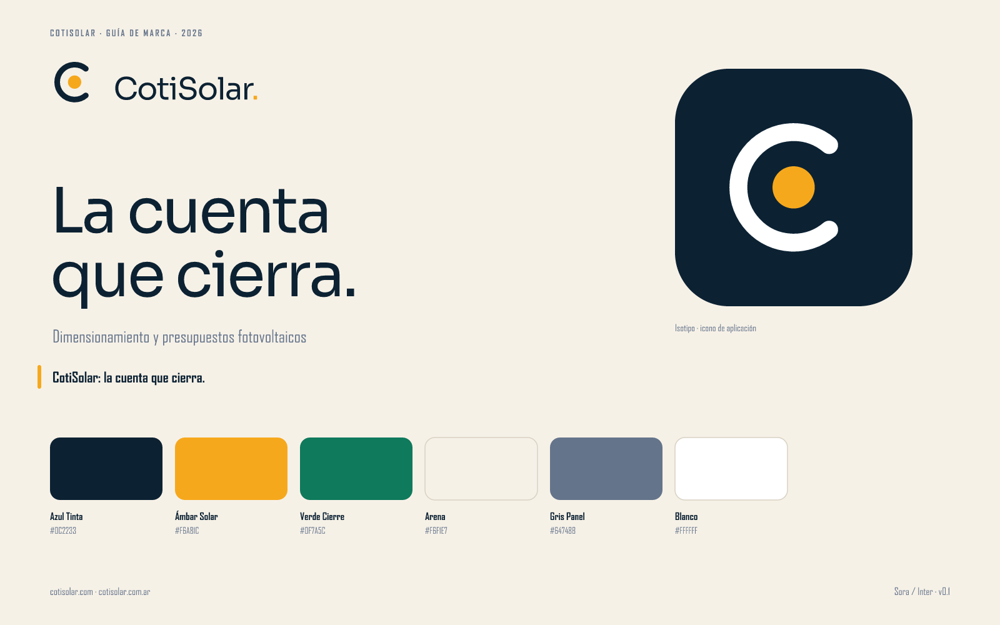
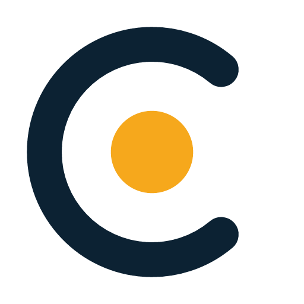
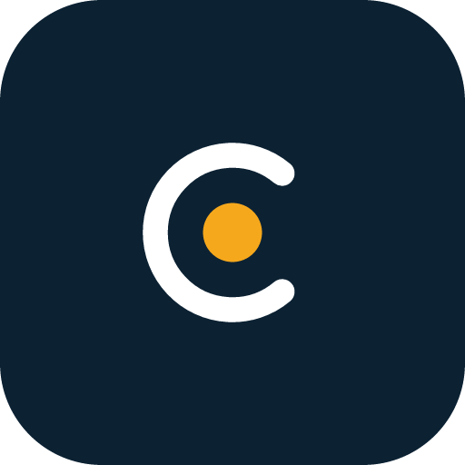
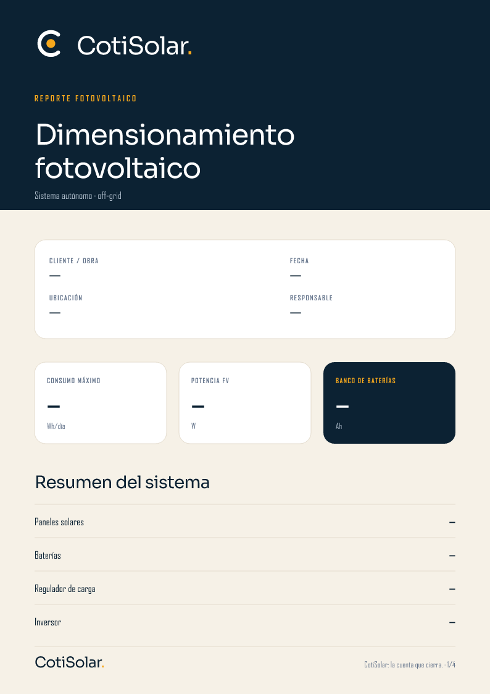
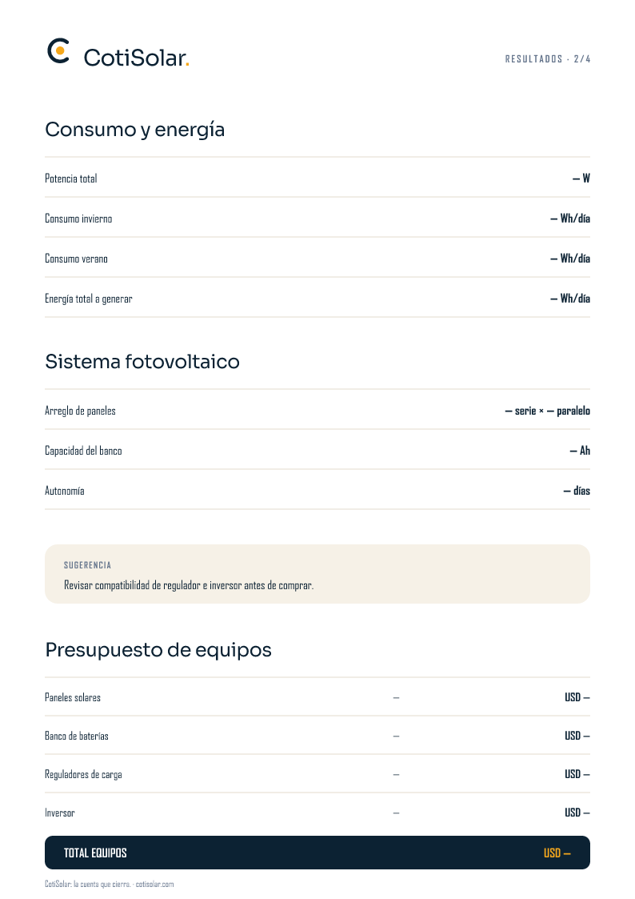
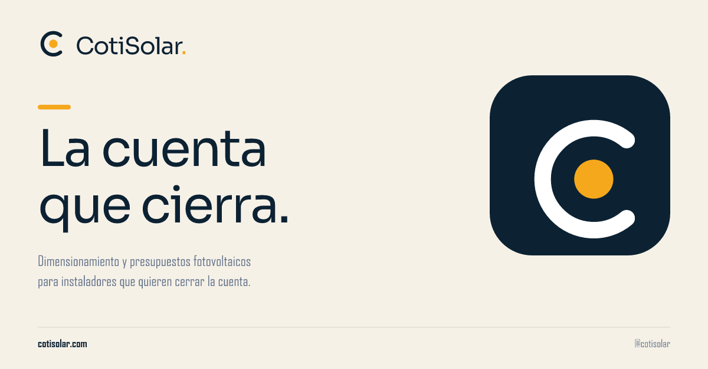
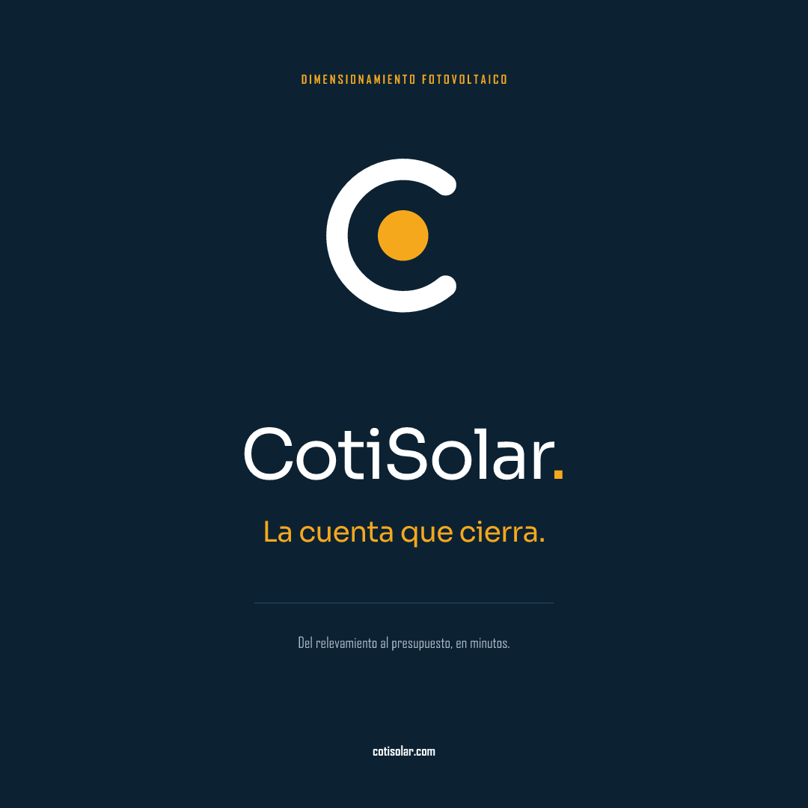

# Guía de marca — CotiSolar

> **Versión 0.1** · 2026-11-25 · Documento de propuesta.
> Producto: **CotiSolar** · Repositorio: `SolarCalculator`.
> Assets de trabajo: [`brand/`](../brand/README.md). Producción outlinada:
> [`brand/production/`](../brand/production/README.md). Plantillas:
> [`brand/templates/`](../brand/templates/README.md).
>
> Los SVG de `brand/` son fuentes editables. La versión de producción ya tiene la
> tipografía outlinada, favicon e iconos PWA. El símbolo fue probado en raster de 16 a
> 64 px; falta la prueba en dispositivos reales.



## 1. Decisión de marca

| Campo | Valor |
|---|---|
| Nombre | **CotiSolar** |
| Slogan principal | **CotiSolar: la cuenta que cierra.** |
| Concepto | **El sol que cierra la cuenta.** |
| Descriptor | Dimensionamiento y presupuestos fotovoltaicos |
| Público | Instaladores, técnicos solares, estudios de ingeniería e integradores de Argentina y LatAm |
| Personalidad | Preciso, confiable, cercano, moderno, sin grandilocuencia |
| Dominio principal | `cotisolar.com` (disponible al 25/11/2026) |
| Dominio Argentina | `cotisolar.com.ar` (disponible al 25/11/2026) |

### Por qué funciona

- **Coti** remite a cotización y a “cotidiano”: una herramienta de todos los días, no un
  laboratorio inaccesible.
- **Solar** dice la categoría sin ambigüedad.
- **“La cuenta que cierra”** tiene doble lectura: la cuenta matemática y la cuenta
  económica. Es una frase criolla, corta y memorable.
- El nombre se pronuncia de forma muy similar en español y en inglés, y se escribe sin
  espacios ni guiones.

### Reglas de escritura

- **CotiSolar**, siempre con “C” y “S” mayúsculas y sin espacio.
- En texto corrido se escribe **CotiSolar**, sin punto: el punto ámbar es un recurso del
  logotipo, no del nombre.
- No usar “Coti Solar”, “Cotisolar” ni “COTISOLAR” en texto corrido; las mayúsculas
  sostenidas se reservan para etiquetas gráficas muy cortas.
- En dominios y usuarios va todo en minúsculas: `cotisolar.com`, `@cotisolar`.

### Slogans de apoyo

Se pueden usar como bajada, campaña o copy secundario, nunca compitiendo con el principal:

- **Del relevamiento al presupuesto, en minutos.**
- **El sol no se improvisa.**
- **Energía bien pensada.**

## 2. Estrategia

### Posicionamiento

> Para instaladores solares que hoy dimensionan con planillas y presupuestos armados a
> mano, **CotiSolar** es la herramienta que convierte consumos y radiación en un sistema
> bien dimensionado y un presupuesto claro, en minutos.

### Promesa

**Menos prueba y error. Más criterio técnico y un presupuesto que se puede defender.**

### Pilares

| Pilar | Qué significa | Cómo se ve |
|---|---|---|
| **Precisión** | Los números importan y se explican. | Fórmulas visibles, unidades claras, supuestos documentados. |
| **Claridad** | El resultado se entiende sin ser ingeniero. | Jerarquía visual, totales destacados, lenguaje simple. |
| **Cercanía** | Habla como un colega, no como un manual. | Voseo, ejemplos concretos, tono humano. |
| **Confianza** | No promete magia; muestra el cálculo. | Reportes con datos de entrada, advertencias y trazabilidad. |

### Arquetipo

**El experto cercano.** Sabe de ingeniería, pero explica como alguien que trabaja en el
techo, no como un paper académico.

### Lo que la marca no es

- No es “greenwashing” ni una marca activista.
- No es un marketplace de paneles.
- No es un software enterprise frío y lleno de jerga.
- No es una calculadora genérica de internet.

## 3. Concepto visual

### “La C que cierra”

El símbolo es una **C** abierta —la C de CotiSolar— con un **sol ámbar** en el centro.
El punto ámbar del logotipo funciona como el sol y como el **punto final** de la frase:
la cuenta que cierra.

```
C abierta  +  sol ámbar  +  punto final
   Coti          energía        cierre
```

- La C también puede leerse como un **panel curvo** o un **aro solar**.
- El sol es el único elemento cálido; todo lo demás es tinta, arena y aire.
- El punto ámbar es el detalle de marca: aparece en el logotipo, en el cierre de frases
  y en los momentos de “resultado” o “listo”.
- El **check** no forma parte del logo principal. Se reserva como sello de
  “presupuesto aprobado” o “cálculo validado”.

## 4. Rutas de marca

| Ruta | Qué es | Fortalezas | Límites | Veredicto |
|---|---|---|---|---|
| **A. Logotipo** | Solo “CotiSolar.” | Elegante, editorial, muy limpio | No tiene ícono para app/favicon; depende de la tipografía | 3/5 |
| **B. Isologotipo** | Símbolo + logotipo horizontal | Versátil, reconocible, funciona en app y en web | Requiere cuidar el espacio y el tamaño mínimo | **5/5 — recomendada** |
| **C. Isologotipo apilado** | Símbolo arriba, logotipo abajo | Ideal para avatar, sello y formatos cuadrados | Menos eficiente en headers anchos | 4/5 — secundaria |

**Recomendación:** usar **B** como identidad principal; **C** para avatar, app icon y
sellos; **A** solo en piezas donde el símbolo no aporte (facturas, membretes muy
angostos).


## 5. Logo principal

### Anatomía

- **Símbolo:** C de trazo grueso, abierta a la derecha, con sol ámbar centrado.
- **Logotipo:** “Coti” en Sora Bold y “Solar” en Sora SemiBold, mismo tamaño óptico.
- **Punto:** ámbar, al final de “Solar”; es parte del logotipo, no un adorno opcional.
- **Relación:** el símbolo pesa visualmente lo mismo que la palabra; no debe quedar
  diminuto al lado de un texto gigante.

### Versiones

| Versión | Archivo | Uso |
|---|---|---|
| Horizontal principal | [`cotisolar-isologo.svg`](../brand/cotisolar-isologo.svg) | Web, header, reportes, firma. |
| Reverso | [`cotisolar-isologo-reverso.svg`](../brand/cotisolar-isologo-reverso.svg) | Fondos azul tinta o fotos oscuras. |
| Apilado | [`cotisolar-isologo-apilado.svg`](../brand/cotisolar-isologo-apilado.svg) | Avatar, sello, formato cuadrado. |
| Solo marca | [`cotisolar-marca.svg`](../brand/cotisolar-marca.svg) | Membretes, facturas, espacios angostos. |
| Isotipo | [`cotisolar-simbolo.svg`](../brand/cotisolar-simbolo.svg) | Favicon, app icon, watermark. |
| App icon | [`cotisolar-app-icon.svg`](../brand/cotisolar-app-icon.svg) | Icono 512 × 512. |

**Producción:** los archivos finales están en
[`brand/production/`](../brand/production/README.md): SVG con tipografía outlinada,
`favicon.ico`, `favicon-16/32/48.png`, `apple-touch-icon.png`, `pwa-192.png` y
`pwa-512.png`.




### Espacio libre y tamaño mínimo

- **Espacio libre:** alrededor del isologotipo, dejar al menos el diámetro del sol
  (26 unidades del SVG) por cada lado.
- **Tamaño mínimo horizontal:** 120 px de ancho en digital; 30 mm en impresión.
- **Tamaño mínimo del isotipo:** 24 px en digital; 8 mm en impresión.
- **Favicon:** probado en raster a 16 px; la C y el sol se distinguen. Si el navegador lo
  reduce más, usar un sol levemente más grande o la C sin sol.

### Fondos

| Fondo | Logo |
|---|---|
| Arena `#F6F1E7` o blanco | Versión principal en azul tinta. |
| Azul tinta `#0C2233` | Versión reversa en blanco + sol ámbar. |
| Foto clara | Versión principal, con overlay suave si hay textura. |
| Foto oscura | Versión reversa, con overlay navy al 40–60 %. |
| Ámbar | Versión principal en azul tinta (contraste 8,15:1); no usar la reversa. |


### Don’ts

- No estirar, rotar, inclinar ni aplicar perspectiva.
- No cambiar el orden “CotiSolar” por “SolarCoti”.
- No separar “Coti” y “Solar” en dos líneas en la versión horizontal.
- No agregar sombras, biseles, brillos, gradientes ni contornos.
- No cambiar el punto ámbar por otro color.
- No usar el sol como letra “O” en “Solar” (el logotipo ya tiene su propio ritmo).
- No poner el logotipo en amarillo sobre blanco: el contraste es 1,99:1.
- No usar la marca vieja “Calculadora Solar” como identidad visible.

## 6. Color

### Paleta principal

| Nombre | HEX | RGB | CMYK aprox. | Rol | Proporción |
|---|---|---|---:|---|---:|
| **Azul Tinta** | `#0C2233` | 12 · 34 · 51 | 80 · 62 · 45 · 60 | Texto principal, header, fondos oscuros | 25 % |
| **Ámbar Solar** | `#F6A81C` | 246 · 168 · 28 | 0 · 65 · 89 · 4 | Sol, CTA, acentos, datos de generación | 10 % |
| **Verde Cierre** | `#0F7A5C` | 15 · 122 · 92 | 85 · 22 · 0 · 44 | Éxito, ahorro, checks, confirmaciones | 5 % |
| **Arena** | `#F6F1E7` | 246 · 241 · 231 | 0 · 2 · 6 · 4 | Fondo principal, superficies cálidas | 25 % |
| **Gris Panel** | `#64748B` | 100 · 116 · 139 | 28 · 17 · 0 · 45 | Texto secundario, líneas, metadatos | 5 % |
| **Blanco** | `#FFFFFF` | 255 · 255 · 255 | 0 · 0 · 0 · 0 | Cards, tablas, aire | 30 % |

> Los CMYK son referenciales. Convertir con el perfil de la imprenta antes de imprimir.

### Contraste y accesibilidad

| Combinación | Ratio | Uso |
|---|---:|---|
| Azul Tinta sobre Arena | 14,44:1 | Texto principal (AAA). |
| Azul Tinta sobre Blanco | 16,25:1 | Texto principal (AAA). |
| Blanco sobre Azul Tinta | 16,25:1 | Header y fondos oscuros (AAA). |
| Ámbar Solar sobre Azul Tinta | 8,15:1 | CTA y destacados (AAA). |
| Blanco sobre Verde Cierre | 5,30:1 | Botones de éxito y badges (AA). |
| Gris Panel sobre Blanco | 4,76:1 | Texto secundario (AA). |
| Verde Cierre sobre Arena | 4,71:1 | Texto de ahorro (AA). |
| **Ámbar sobre Blanco** | **1,99:1** | **Prohibido como texto.** Solo formas y acentos. |

Reglas:

- El ámbar es un acento, no un color de texto sobre fondos claros.
- Para botones primarios: fondo ámbar, texto azul tinta.
- Para éxito: fondo verde, texto blanco (AA).
- Para links y texto: azul tinta; el ámbar no reemplaza al azul en lectura.
- No usar negro puro: el “negro” de la marca es azul tinta.
- No usar degradados multicolor ni “sunset gradients”.

### Datos y gráficos

| Serie | Color |
|---|---|
| Generación solar | Ámbar `#F6A81C` |
| Consumo | Azul Tinta `#0C2233` |
| Ahorro / positivo | Verde Cierre `#0F7A5C` |
| Referencia / grilla | Gris Panel `#64748B` |
| Fondo de gráfico | Blanco o Arena |

### Modo oscuro (propuesta)

| Token | HEX |
|---|---|
| Superficie | `#132B40` |
| Superficie elevada | `#1B3852` |
| Borde | `#2A4A66` |
| Texto | `#F6F1E7` |
| Texto secundario | `#A9B8C6` |
| Acento | `#F6A81C` |

## 7. Tipografía

### Familias

| Uso | Familia | Pesos | Fuente |
|---|---|---|---|
| Títulos, logo, números grandes | **Sora** | 600 / 700 | [Google Fonts](https://fonts.google.com/specimen/Sora) |
| Texto de UI, tablas, párrafos | **Inter** | 400 / 500 / 600 | [Google Fonts](https://fonts.google.com/specimen/Inter) |

Ambas son gratuitas (OFL) y funcionan bien en web y en impresión. No usar una tercera
familia.

### Escala

| Token | Tamaño / línea | Peso | Uso |
|---|---|---|---|
| Display | 64 / 72 | Sora 700 | Hero, portada de reporte |
| H1 | 40 / 48 | Sora 700 | Título de pantalla |
| H2 | 28 / 36 | Sora 600 | Secciones |
| H3 | 20 / 28 | Sora 600 | Cards y subtítulos |
| Body | 16 / 24 | Inter 400 | Texto general |
| Body strong | 16 / 24 | Inter 600 | Énfasis y labels |
| Small | 14 / 20 | Inter 500 | Metadatos, ayudas |
| Caption | 12 / 16 | Inter 500 | Legal, unidades |
| Número | 28 / 32 | Inter 600 tabular | Totales y resultados |

Reglas:

- Tracking de títulos: −1 % a −2 %.
- Números de tablas y resultados: **tabular nums** para que las columnas no bailen.
- No usar mayúsculas sostenidas en párrafos; sí en labels cortos.
- El logotipo se dibuja con Sora 700/600 y tracking −2 %; para producción, outlinear.

## 8. Sistema gráfico y UI

### Formas

- Radio de cards: 16 px; radio de botones: 12 px; radio de inputs: 10 px.
- Bordes de 1 px, color `#E4DCCD` sobre Arena y `#2A4A66` en modo oscuro.
- Sombras suaves y bajas; evitar sombras difusas grandes.
- Mucho aire: la marca vende claridad, no densidad.

### Iconografía

- Íconos de línea, 1,5–2 px, esquinas redondeadas.
- Estilo consistente: sol, panel, batería, inversor, check, descarga.
- No mezclar íconos rellenos y de línea en la misma pantalla.

### Fotografía

- Instalaciones reales, techos, manos trabajando, tableros, herramientas.
- Luz natural; evitar atardeceres genéricos, campos de paneles infinitos y stock sonriente.
- Si se usa foto de fondo, overlay navy al 40–60 % para legibilidad.

### Aplicación en UI

| Elemento | Tratamiento |
|---|---|
| Header | Fondo Azul Tinta, logo reverso, texto Arena. |
| Fondo de app | Arena o blanco; cards blancas. |
| CTA primario | Fondo Ámbar Solar, texto Azul Tinta, radio 12. |
| CTA secundario | Borde Azul Tinta, fondo transparente, texto Azul Tinta. |
| Éxito | Fondo Verde Cierre, texto blanco, ícono check. |
| Error | Rojo funcional `#B42318` (solo UI, no marca). |
| Tablas | Header Arena, filas blancas, líneas `#E4DCCD`, números tabulares. |
| Gráficos | Generación ámbar, consumo azul, ahorro verde. |

### Reportes

- Portada: logo, título “Dimensionamiento fotovoltaico”, cliente/ubicación, fecha.
- Cuerpo: datos de entrada, fórmulas y supuestos, resultados, advertencias.
- Cierre: logo + slogan + página.
- El reporte debe verse bien en blanco y negro; el color no puede ser la única señal.

## 9. Voz y tono

### Principios

- **Claro:** explicar sin infantilizar.
- **Preciso:** decir qué se asume y qué no.
- **Cercano:** hablar como un colega; voseo rioplatense.
- **Sin humo:** nada de “revolucionar”, “disrumpir” ni “IA mágica”.

### Do / Don’t

| Hacer | Evitar |
|---|---|
| “Del relevamiento al presupuesto, en minutos.” | “Revolucioná la industria solar.” |
| “Este cálculo asume 3 días de autonomía.” | “Cálculo perfecto garantizado.” |
| “Revisá la potencia del panel.” | “Error 422.” |
| “Te mostramos cómo llegamos al número.” | “Nuestro algoritmo propietario.” |
| “CotiSolar: la cuenta que cierra.” | “CotiSolar: la solución integral 360.” |

### Microcopy

- Botón principal: **Calcular sistema**.
- Acción secundaria: **Ver presupuesto**.
- Empty state: **Todavía no cargaste consumos. Empezá por acá.**
- Error: **La potencia del panel tiene que ser mayor a 0.**
- Éxito: **Listo. El presupuesto está calculado.**

## 10. Do / Don’t de marca

| Hacer | Evitar |
|---|---|
| Usar el isologotipo horizontal como principal. | Inventar variantes con el sol en otro color. |
| Mantener el punto ámbar como cierre. | Reemplazarlo por un check o una “O”. |
| Usar Sora + Inter. | Mezclar tres tipografías. |
| Reservar el ámbar para acentos y CTA. | Usar ámbar como texto sobre blanco. |
| Mostrar números y supuestos. | Prometer resultados sin contexto. |
| Usar fotos reales de instalaciones. | Stock de atardeceres y paneles infinitos. |
| Hablar en voseo claro. | Jerga corporativa o técnica sin explicación. |

## 11. Aplicaciones

### App icon


- Fondo Azul Tinta, C blanca, sol ámbar.
- Probar en iOS, Android, favicon y PWA.
- En 16 px, si el sol se pierde, usar la C sin sol o un sol más grande.

### Avatar / redes

- Usar el isotipo sobre Azul Tinta.
- Para LinkedIn/Instagram, usar la versión apilada si el círculo recorta el horizontal.
- Nombre de usuario sugerido: `@cotisolar`.

### Firma de email

```
Nombre Apellido
CotiSolar · Dimensionamiento y presupuestos fotovoltaicos
cotisolar.com · +54 9 11 ...
```

### Reporte

- Header con logo reverso sobre Azul Tinta.
- Título en Sora 40.
- Tablas con números tabulares.
- Footer: “CotiSolar: la cuenta que cierra.” + página.

### Plantillas

Plantillas editables en [`brand/templates/`](../brand/templates/README.md):








- [Portada de reporte](../brand/templates/reporte-portada.svg)
- [Resultados de reporte](../brand/templates/reporte-resultados.svg)
- [LinkedIn 1200 × 627](../brand/templates/social-linkedin.svg)
- [Cuadrado 1080 × 1080](../brand/templates/social-cuadrado.svg)
- [Firma de email](../brand/templates/firma-email.html)

## 12. Assets y próximos pasos

### Archivos creados

- [Isologotipo horizontal](../brand/cotisolar-isologo.svg)
- [Isologotipo reverso](../brand/cotisolar-isologo-reverso.svg)
- [Isologotipo reverso sobre fondo oscuro](../brand/cotisolar-isologo-reverso-preview.svg)
- [Isologotipo apilado](../brand/cotisolar-isologo-apilado.svg)
- [Solo marca](../brand/cotisolar-marca.svg)
- [Isotipo](../brand/cotisolar-simbolo.svg)
- [App icon](../brand/cotisolar-app-icon.svg)
- [Tablero de marca](../brand/cotisolar-brand-board.svg)
- [Producción outlinada + favicon/PWA](../brand/production/README.md)
- [Plantillas de reporte y redes](../brand/templates/README.md)
- [Previews PNG](../brand/README.md) para documentación y revisión

### Pendientes antes de producción

1. Revisar el dibujo de la C con un diseñador; los SVG de `brand/production/` ya están
   outlinados.
2. Probar el isotipo en navegador y dispositivos reales; ya se validó en raster a
   **16, 24, 32, 48 y 64 px** y se reconoce.
3. Validar contraste en pantalla y en impresión; convertir CMYK con perfil real.
4. Definir tokens de diseño (color, tipografía, spacing, radios) para la futura UI.
5. Ajustar las plantillas de reporte/redes con datos reales y el logo de producción.
6. Los favicon/PWA y el manifest ya están integrados en `public/`; falta probar la
   instalación PWA en Android/iOS.
7. Revisar la accesibilidad del logo y de la paleta con usuarios reales.

> Esta guía es una propuesta de dirección, no un manual cerrado. La validación con
> instaladores quedó pendiente por decisión del equipo; los próximos pasos técnicos están
> en [roadmap.md](./roadmap.md).
